<picture>
  <source media="(prefers-color-scheme: dark)" srcset="assets/header-dark.svg">
  
</picture>

  
  

Software engineer working across full-stack development, financial systems, data, and intelligent automation, with a strong foundation in backend engineering.

Previously led backend development for branch banking microservices as the sole backend engineer in a five-person team. Computer Science valedictorian at Universitas Muhammadiyah Yogyakarta (UMY) and published IEEE research co-author.

Most of my professional work lives in private repositories due to employer confidentiality.

<picture>
  <source media="(prefers-color-scheme: dark)" srcset="assets/stack-dark.svg">
  
</picture>

### Selected Work

<b>Branch Banking Microservices</b> · Banking · 2024–25

 

Backend for the bank's teller application, supporting customer lookup, account opening, cash deposits and withdrawals, transaction fees, and multiple currencies. I served as team lead and the sole backend engineer in a five-person team.

- Seven Spring Boot services behind a Spring Cloud gateway, integrated with Oracle and the Temenos core banking system.
- Documented APIs using Swagger/OpenAPI and managed development through GitLab.
- Profiled and optimized request handling to improve processing performance under load.

*Employer project; source code is private.*

<b>Dividend Calculation Engine</b> · Fintech · 2025

 

Backend architecture for a high-volume financial platform, supporting automated transaction workflows and a scalable dividend calculation engine.

*Employer project under NDA; details limited to what can be shared.*

<b>Customer Churn Prediction</b> · BNSP Data Science Certification · 2025

 

A machine learning project predicting which telecom customers are likely to leave and identifying factors associated with customer churn.

- Integrated data from SQL Server, Excel, and CSV; identified churn-related factors through hypothesis testing.
- Compared nine classification models, applying SMOTE to address class imbalance and hyperparameter tuning to optimize the best-performing models.
- Gradient Boosting achieved **0.86 recall**, correctly identifying 86% of churned customers, while Random Forest achieved **0.88 accuracy** on held-out test data.

<b>Community Data Platform</b> · Yemeni Students Union in Indonesia · 2024–25

 

The union's first comprehensive data study, combining student records, dashboards, and analysis of Yemeni students across 60+ Indonesian universities.

- Cleaned and analyzed Arabic and English survey data; applied clustering (K-Means, PCA), correlation, and regression techniques.
- Developed interactive visualizations using Plotly and a geographic map using Folium.
- Findings contributed to the union's decision to establish a dedicated IT department.

<b>Contacts API & Android Application</b> · Course Project · 2023

 

A Spring Boot REST API backed by MySQL, integrated with a native Android application built using Kotlin and Jetpack Compose, with Retrofit handling client-server communication.

[View Android Application](https://github.com/osamabq-me/152_RestAPI)

 

<picture>
  <source media="(prefers-color-scheme: dark)" srcset="assets/overview-dark.svg">
  
</picture>

<picture>
  <source media="(prefers-color-scheme: dark)" srcset="assets/activity-dark.svg">
  
</picture>

<picture>
  <source media="(prefers-color-scheme: dark)" srcset="assets/langbars-dark.svg">
  
</picture>

  

