<picture>
  <source media="(prefers-color-scheme: dark)" srcset="assets/header-dark.svg">
  
</picture>

  
  

Software engineer working across full-stack development, financial systems, data, and intelligent automation, with a strong foundation in backend engineering.

Currently a Software Developer in fintech, where I built a crypto payments and dividend platform end to end, from the React front end to the Spring Boot backend and on-chain payment verification. Previously the sole backend engineer on a five-person team building branch banking microservices. Computer Science valedictorian at Universitas Muhammadiyah Yogyakarta (UMY) and published IEEE research co-author.

Most of my professional work lives in private repositories due to employer confidentiality.

<picture>
  <source media="(prefers-color-scheme: dark)" srcset="assets/stack-dark.svg">
  
</picture>

### Selected Work

<b>Crypto Payments & Dividend Platform</b> · Fintech · 2025–present

 

A full-stack payments and dividend platform I built from scratch on my own: the public website, the admin back office and the backend.

- React (Vite) website and back office: a multi-step buying wizard, wallet and transaction history, live supply updates over server-sent events, and analytics with Excel/CSV export.
- On-chain payment verification: every blockchain transfer is checked against a BNB Smart Chain node, and users prove wallet ownership by signing a challenge (WalletConnect).
- Safe money movement: the same transfer can never be credited twice, even under concurrent retries; automatic demand-based pricing locks the buyer's price during payment.
- Dividend engine that snapshots every holder's balance and credits each holder proportionally in one transaction.
- Security and reliability: email verification, rotating JWT sessions in httpOnly cookies, CAPTCHA, new-device alerts, an email outbox with retries, and a reconciliation sweep that flags unmatched transfers.
- Java, Spring Boot, MySQL, Swagger/OpenAPI, monitored with Prometheus and Grafana, deployed with Docker and nginx.

*Employer project; source code is private.*

<b>Wi-Fi Sensing on Android Devices</b> · IoT · Ongoing

 

Cross-compiled a Realtek USB Wi-Fi driver for Android 11 (Linux kernel 4.19) on Orange Pi boards and loaded it over ADB.

- Extended the devices' weak Wi-Fi range.
- Enabled monitor mode, so the devices capture Wi-Fi probe requests to estimate how many people are nearby (validated with airodump-ng).

*Employer project; source code is private.*

<b>Branch Banking Microservices</b> · Banking · 2024–25

 

Backend for a bank's teller application, covering customer lookup, account opening, cash deposits and withdrawals, transaction fees, and multiple currencies. I was the sole backend engineer on a five-person team.

- Spring Boot microservices that replaced a legacy framework, integrated with Oracle and the Temenos core banking system.
- Documented APIs with Swagger/OpenAPI and delivered faster API responses.
- Ran development and CI/CD through GitLab from build to launch and handover.

*Employer project under NDA; source code is private.*

<b>Customer Churn Prediction</b> · BNSP Data Science Certification · 2025

 

A machine learning project predicting which telecom customers are likely to leave and identifying factors associated with customer churn.

- Integrated data from SQL Server, Excel, and CSV; identified churn-related factors through hypothesis testing and feature engineering.
- Compared nine classification models on accuracy, precision, recall, F1 and ROC-AUC, using SMOTE for class imbalance, cross-validation and Random Forest tuning.
- Random Forest reached **85.84% accuracy**; Gradient Boosting caught **85.70%** and KNN **90.42%** of customers who churned (recall).

<b>Community Data Platform</b> · Yemeni Students Union in Indonesia · 2024–26

 

The union's first comprehensive data study of Yemeni students across 58 Indonesian universities and 66 fields of study, combining student records, dashboards, and analysis.

- Cleaned and analyzed Arabic and English survey data with descriptive statistics and relational (bivariate and multivariate) analysis.
- Built interactive visualizations with Plotly and geographic maps with Folium and Leaflet.js.
- Findings contributed to the union's decision to establish a dedicated IT department; the study is being prepared for journal publication.

<b>Contacts API & Android Application</b> · Course Project · 2023

 

A Spring Boot REST API backed by MySQL, integrated with a native Android application built using Kotlin and Jetpack Compose, with Retrofit handling client-server communication.

[View Android Application](https://github.com/osamabq-me/152_RestAPI)

 

<picture>
  <source media="(prefers-color-scheme: dark)" srcset="assets/overview-dark.svg">
  
</picture>

<picture>
  <source media="(prefers-color-scheme: dark)" srcset="assets/activity-dark.svg">
  
</picture>

<picture>
  <source media="(prefers-color-scheme: dark)" srcset="assets/langbars-dark.svg">
  
</picture>

  

